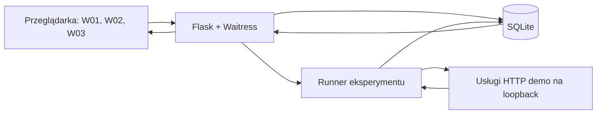

# RiskR — technologie wersji v1

**Zespół:** Mateusz Zyra i Adam Wójciak.

## Porównanie wariantów

| Obszar | Wariant A | Wariant B |
|---|---|---|
| Interfejs | HTML, CSS, JavaScript, Jinja | React, TypeScript, Vite |
| Serwer | Python, Flask, Waitress | Python, FastAPI, Uvicorn |
| Dane | SQLite przez `sqlite3` | PostgreSQL i SQLAlchemy |
| Uruchamianie | Jeden proces aplikacji i plik bazy | Osobny frontend, API i serwer bazy |
| Zaleta | Mało zależności i prosty start lokalny | Wygodny rozwój większego API i interfejsu |
| Koszt organizacyjny | Mały; brak kompilowania interfejsu | Konfiguracja kilku usług i środowiska Node.js |

**Wybrany wariant: A.**

## Uzasadnienie wyboru

Flask pozwala połączyć trzy widoki RiskR z obsługą formularzy i niewielkim API w jednej aplikacji. HTML i CSS wystarczają do odwzorowania szkiców, a JavaScript odpowiada za zmianę parametrów formularza i odświeżanie pomiarów. Szablony Jinja umożliwiają wspólną nawigację oraz bezpieczne wyświetlanie komunikatów. SQLite zapewnia trwały zapis bez instalowania osobnego serwera bazy, co odpowiada jednoosobowemu trybowi lokalnemu v1. Standardowe moduły Pythona obsługują serwer usług demonstracyjnych, żądania HTTP, wątki i testy. Waitress uruchamia aplikację na Windows bez trybu debugowania i bez automatycznego tworzenia drugiego procesu runnera. PostgreSQL i oddzielny frontend pozostają możliwym kierunkiem rozwoju po wprowadzeniu wielu użytkowników lub zdalnych środowisk.

## Narzędzia i wersje

| Element | Wersja w sprawdzonym środowisku | Rola |
|---|---|---|
| System | Windows 11 | Lokalne uruchomienie i testy |
| Python | 3.12.14 | Logika aplikacji, runner i moduły standardowe |
| Flask | 3.1.3 | Routing, formularze, sesja, JSON i szablony |
| Waitress | 3.0.2 | Serwer WSGI dostępny domyślnie na `127.0.0.1` |
| Jinja2 | 3.1.6 | Renderowanie widoków W01–W03 |
| Werkzeug | 3.1.9 | Obsługa HTTP i klient testowy Flask |
| SQLite | 3.53.1 | Trwała baza `instance/riskr.sqlite3` |
| HTML / CSS / JavaScript | Standardy obsługiwane przez współczesną przeglądarkę | Widoki, układ i odświeżanie pomiarów |
| Git | 2.55.0.windows.3 | Historia zmian i współpraca |
| `unittest` | Biblioteka standardowa Pythona 3.12 | Testy reguł i integracji |
| Docker Compose | Konfiguracja przygotowana; bez uruchomienia w środowisku testowym | Opcjonalny wariant kontenerowy |

Pełne wersje zależności są przypięte w [requirements.txt](../requirements.txt). SQLite jest dostarczany z Pythonem; jego wersja może się różnić między instalacjami. Projekt nie wymaga klucza API ani płatnej usługi.

## Architektura i przepływ danych

1. W02 wysyła usługę, scenariusz, intensywność i czas do serwera.
2. Serwer sprawdza dane i zapisuje szkic eksperymentu.
3. Runner sprawdza gotowość i aktywuje wybrane zakłócenie.
4. Osobne sondy HTTP mierzą odpowiedzi; dodatkowy ruch przeciążenia nie jest doliczany do sond.
5. Zagregowane pomiary trafiają do bazy, a W03 odczytuje je co 5 sekund.
6. Upływ czasu lub polecenie zatrzymania usuwa zakłócenie i kończy eksperyment.

## Dostosowanie mapy z laboratorium 02

- PostgreSQL zastąpiono SQLite. UUID i czas UTC mają reprezentację `TEXT`, liczniki `INTEGER`, a średni czas odpowiedzi `REAL`.
- Zachowano cztery tabele, relacje 1:N, kontrolę kluczy obcych, parametryzowane zapytania i ograniczenia danych.
- Zamiast blokady rekordu PostgreSQL stosowane są transakcja `BEGIN IMMEDIATE` oraz unikalny indeks dopuszczający jeden aktywny eksperyment. Blokada pliku zapobiega uruchomieniu drugiego procesu aplikacji na tej samej bazie.
- Wariant lokalny testuje dwie wbudowane usługi HTTP w procesie aplikacji. Cele są zapisane w kodzie i osiągalne wyłącznie przez `127.0.0.1`; formularz nie umożliwia podania zewnętrznego adresu.
- Zakłócenia realizuje warstwa odpowiedzi usług demonstracyjnych: HTTP 500, opóźnienie i zamknięcie połączenia. Przeciążenie tworzy rzeczywiste dodatkowe żądania HTTP z limitem 50 żądań/s i 10 równoległych żądań.
- Tryb lokalny zapewnia ograniczenie celów testu, lecz nie izolację systemową. Wariant `compose.yaml` dodaje kontener, sieć `internal`, ograniczenia zasobów i publikację portu wyłącznie na localhost. Uruchomienie i izolacja kontenera wymagają osobnego potwierdzenia na komputerze z Dockerem.
- Zakres F02–F05 pozostaje zgodny z mapą. F01 jest zrealizowane dla lokalnego laboratorium demo; weryfikacja pełnej izolacji kontenerowej pozostaje poza wykonanymi testami.

## Role widoku, serwera i bazy — przykład rezerwacji sali

Widok pokazuje dostępne sale i formularz wyboru terminu. Serwer sprawdza, czy początek poprzedza koniec i czy termin nie koliduje z inną rezerwacją. Baza zapisuje salę, użytkownika, termin i status, dzięki czemu rezerwacja pozostaje po restarcie. W RiskR analogicznie W02 zbiera parametry, Flask sprawdza reguły eksperymentu, a SQLite przechowuje konfigurację i pomiary.

## Materiały techniczne

- [Flask — instalacja i środowisko wirtualne](https://flask.palletsprojects.com/en/stable/installation/).
- [Python — moduł sqlite3](https://docs.python.org/3/library/sqlite3.html).
- [Docker Compose — konfiguracja sieci](https://docs.docker.com/reference/compose-file/networks/).
