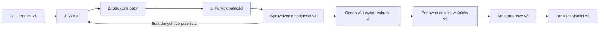
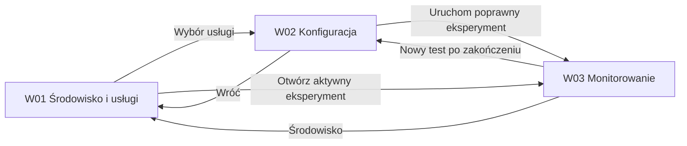
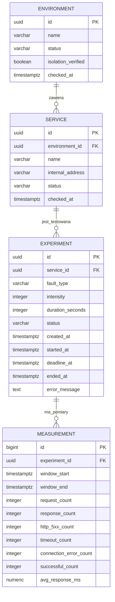

# RiskR — mapa pierwszej wersji projektu

Laboratorium 02: Road Map projektu.

**Projekt:** RiskR — bezpieczne środowisko do wykrywania słabości systemów informatycznych.

**Zespół:** Mateusz (Osoba A) i Kamil (Osoba B).

**Proponowany termin oddania:** 2 grudnia 2026 r.

> Imiona, daty i podział pracy są przykładowe i wymagają dostosowania przez zespół. Adresy repozytorium GitHub i przestrzeni LaboChat pozostają do uzupełnienia. Dokument opisuje plan aplikacji, a nie już wdrożone funkcje.

## 1. Cel i granice wersji v1

**Główny odbiorca:** programista lub tester, który chce sprawdzić odporność własnej aplikacji na kontrolowane awarie.

**Najważniejszy cel v1:** umożliwić wykonanie kontrolowanego eksperymentu awaryjnego w izolowanym środowisku oraz obserwowanie bieżącej reakcji testowanej usługi.

Użytkownik wybierze przygotowaną usługę testową działającą w odizolowanym środowisku. Następnie określi rodzaj zakłócenia, jego intensywność i czas trwania. Po uruchomieniu eksperymentu będzie obserwować czas odpowiedzi, liczbę błędów i dostępność usługi. Eksperyment zakończy się automatycznie po wyznaczonym czasie lub wcześniej na żądanie użytkownika. Efektem będzie możliwość zaobserwowania problemów w obsłudze awarii bez oddziaływania na system produkcyjny.

### Zakres MVP

| ID | Funkcjonalność z laboratorium 01 | Zakres |
|---|---|---|
| F01 | Użytkownik może przeprowadzać eksperymenty na aplikacjach i usługach w bezpiecznym, izolowanym środowisku testowym. | MVP |
| F02 | Użytkownik może wybrać scenariusz awarii: błędy HTTP 500, zwiększone opóźnienia odpowiedzi, przeciążenie lub czasową niedostępność usługi. | MVP |
| F03 | Użytkownik może skonfigurować eksperyment, wskazując testowaną usługę, intensywność zakłócenia oraz czas jego trwania. | MVP |
| F04 | Użytkownik może uruchomić eksperyment oraz zatrzymać go przed upływem zaplanowanego czasu. | MVP |
| F05 | Użytkownik może monitorować w czasie rzeczywistym czas odpowiedzi, liczbę błędów oraz dostępność testowanych usług. | MVP |

### Poza pierwszą wersją

| ID | Odłożona funkcja | Powód odłożenia |
|---|---|---|
| F06 | Przeglądanie wyników zakończonego eksperymentu na wykresach i w statystykach. | W v1 priorytetem są uruchomienie eksperymentu i bieżące pomiary; analiza historii powstanie później. |
| F07 | Porównywanie działania systemu przed zakłóceniem, podczas niego i po zakończeniu. | Wymaga wyróżnienia faz eksperymentu i dodatkowej analizy danych. |
| F08 | Generowanie raportu z konfiguracją, pomiarami i zaobserwowanymi problemami. | Wymaga gotowego modelu wyników i mechanizmu tworzenia dokumentów. |

### Założenia ograniczające v1

- Jedno lokalne stanowisko i jeden użytkownik; bez rejestracji, logowania i zarządzania rolami.
- Jedno przygotowane środowisko kontenerowe z usługami demonstracyjnymi. Użytkownik wybiera usługę z listy; nie podaje dowolnego adresu systemu zewnętrznego.
- Jeden aktywny eksperyment w środowisku i jeden rodzaj zakłócenia na eksperyment.
- Czas zakłócenia od 1 do 300 sekund. Limity intensywności opisano w punkcie 5.
- Monitorowanie na żywo przedstawia wartości liczbowe oraz tabelę ostatnich pomiarów; nie obejmuje jeszcze historycznych wykresów ani raportów.
- Dane pozostają po zakończeniu eksperymentu jako podstawa przyszłych funkcji F06–F08. Samo ich przechowywanie nie oznacza udostępnienia analizy historycznej w v1.

## 2. Cykl tworzenia kolejnych wersji



Najpierw ustalamy, co użytkownik zobaczy i wprowadzi. Na tej podstawie określamy przechowywane dane, a następnie opisujemy działanie funkcji. Odkrycie brakującego pola lub stanu wymaga aktualizacji odpowiedniego widoku, modelu danych i opisu funkcji. Po ocenie v1 zaczynamy ten sam cykl dla v2.

## 3. Widoki, szkice i nawigacja

### Zestawienie widoków

| ID | Widok | Użytkownik i cel | Powiązane funkcje |
|---|---|---|---|
| W01 | Środowisko i usługi | Programista/tester sprawdza gotowość izolowanego środowiska i wybiera usługę. | F01, F03 |
| W02 | Konfiguracja eksperymentu | Programista/tester wybiera scenariusz, ustala parametry, zapisuje konfigurację i uruchamia test. | F02, F03, F04 |
| W03 | Monitorowanie eksperymentu | Programista/tester obserwuje pomiary i stan eksperymentu oraz może zatrzymać zakłócenie. | F04, F05 |

### W01 — Środowisko i usługi

```text
+------------------------------------------------------------------+
| RiskR                                  Środowisko | Eksperyment   |
+------------------------------------------------------------------+
| Środowisko testowe: lokalne-lab                                    |
| Stan środowiska: GOTOWE               Izolacja: POTWIERDZONA      |
|                                                                  |
| Wybierz usługę:                                                   |
| (x) demo-api          Stan: dostępna                              |
| ( ) demo-worker       Stan: dostępna                              |
|                                                                  |
| [Sprawdź gotowość]                [Konfiguruj eksperyment -> W02]  |
| Komunikat: Środowisko jest gotowe do eksperymentu.                 |
+------------------------------------------------------------------+
```

- **Wyświetlane dane:** nazwa i status środowiska, potwierdzenie izolacji, nazwy i stany usług, informacja o trwającym eksperymencie.
- **Wprowadzane dane:** wybór jednej usługi z listy.
- **Po powodzeniu:** pojawia się komunikat o gotowości; wybór usługi przenosi do W02.
- **Po błędzie:** komunikat „Nie można potwierdzić izolacji środowiska. Uruchomienie eksperymentu jest zablokowane”. Użytkownik może ponowić sprawdzenie.
- **Ograniczenie:** niedostępna usługa przed rozpoczęciem testu albo aktywny eksperyment blokują rozpoczęcie nowego testu; aktywny test można otworzyć w W03.

### W02 — Konfiguracja eksperymentu

```text
+------------------------------------------------------------------+
| RiskR                                  Środowisko | Eksperyment   |
+------------------------------------------------------------------+
| Nowy eksperyment                                                  |
| Usługa: [demo-api v]                                              |
| Scenariusz: [Opóźnienie odpowiedzi v]                             |
| Intensywność: [500] ms                                            |
| Czas trwania: [60] s                                              |
|                                                                  |
| Dostępne scenariusze: HTTP 500 / opóźnienie / przeciążenie /       |
|                      niedostępność                               |
| Status konfiguracji: poprawna                                    |
|                                                                  |
| [Wróć -> W01]  [Zapisz konfigurację]  [Uruchom -> W03]             |
| Komunikat: Konfiguracja została zapisana.                         |
+------------------------------------------------------------------+
```

- **Wyświetlane dane:** wybrana usługa, lista scenariuszy, jednostka i zakres intensywności, zapisane parametry oraz komunikaty walidacji.
- **Wprowadzane dane:** usługa, rodzaj zakłócenia, intensywność i czas trwania. Dla niedostępności intensywność wynosi stale 100% i pole nie jest edytowalne.
- **Po zapisaniu:** konfiguracja otrzymuje identyfikator i status `draft`; użytkownik pozostaje w W02.
- **Po uruchomieniu:** system zapisuje aktualną konfigurację, ponownie sprawdza warunki uruchomienia i otwiera W03 z informacją o rozpoczynaniu testu.
- **Po błędzie:** przy polu pojawia się np. „Czas trwania musi wynosić od 1 do 300 s”; błędna konfiguracja nie jest zapisywana ani uruchamiana.
- **Nawigacja:** powrót do W01; po uruchomieniu przejście do W03. Parametry uruchomionego eksperymentu nie są edytowalne.

### W03 — Monitorowanie eksperymentu

```text
+------------------------------------------------------------------+
| RiskR                                  Środowisko | Eksperyment   |
+------------------------------------------------------------------+
| Eksperyment #12                       Status: TRWA                |
| demo-api | opóźnienie 500 ms | zaplanowano 60 s                    |
| Pozostało: 42 s                       [Zatrzymaj eksperyment]     |
|                                                                  |
| Czas odpowiedzi: 620 ms  | Błędy HTTP 5xx: 0 | Dostępność: 100%    |
| Okno pomiarowe: ostatnie 5 s                                      |
|                                                                  |
| Czas     | Próby | Odpowiedzi | HTTP 5xx | Timeouty | Śr. czas     |
| 12:00:15 |   5   |     5      |    0     |    0     | 620 ms       |
| 12:00:10 |   5   |     5      |    0     |    0     | 618 ms       |
|                                                                  |
| Ostatnia aktualizacja: 12:00:15                                   |
| Komunikat: Eksperyment trwa.                                      |
| [Środowisko -> W01]  [Nowy eksperyment -> W02, po zakończeniu]     |
+------------------------------------------------------------------+
```

- **Wyświetlane dane:** identyfikator, konfiguracja, status, czas rozpoczęcia i zakończenia, pozostały czas, ostatnie pomiary i czas aktualizacji.
- **Wprowadzane dane:** polecenie zatrzymania; formularz parametrów nie występuje.
- **Po powodzeniu:** odświeżanie co 5 s; po usunięciu zakłócenia status `completed` albo `stopped` i komunikat o zakończeniu. Ostatni pomiar pozostaje widoczny w bieżącym widoku.
- **Po błędzie zbierania pomiarów:** „Brak aktualnych danych”; ostatnie wartości mają oznaczenie jako nieaktualne. Brak telemetrii nie jest pokazywany jako 0% dostępności.
- **Po błędzie sprzątania:** status `cleanup_failed`, komunikat o niepotwierdzonym usunięciu zakłócenia i blokada kolejnego eksperymentu do przywrócenia gotowości.
- **Nawigacja:** powrót do W01 nie zatrzymuje testu. Ponowne otwarcie aktywnego eksperymentu prowadzi do W03. Nowy test można konfigurować po zakończeniu poprzedniego i potwierdzeniu gotowości środowiska.

### Przejścia



## 4. Struktura bazy danych

Proponowany silnik: PostgreSQL. `PK` oznacza klucz główny, `FK` klucz obcy, `NULL` wartość opcjonalną. Brak tabeli użytkowników wynika z lokalnego, jednoosobowego sposobu korzystania z v1.

### Tabele i pola

| Tabela | Podstawowe pola i typy |
|---|---|
| `environment` | `id UUID PK`; `name VARCHAR(100)`; `status VARCHAR(30)`; `isolation_verified BOOLEAN`; `checked_at TIMESTAMPTZ NULL` |
| `service` | `id UUID PK`; `environment_id UUID FK → environment.id`; `name VARCHAR(100)`; `internal_address VARCHAR(255)`; `status VARCHAR(30)`; `checked_at TIMESTAMPTZ NULL` |
| `experiment` | `id UUID PK`; `service_id UUID FK → service.id`; `fault_type VARCHAR(30)`; `intensity INTEGER`; `duration_seconds INTEGER`; `status VARCHAR(30)`; `created_at TIMESTAMPTZ`; `started_at TIMESTAMPTZ NULL`; `deadline_at TIMESTAMPTZ NULL`; `ended_at TIMESTAMPTZ NULL`; `error_message TEXT NULL` |
| `measurement` | `id BIGINT PK`; `experiment_id UUID FK → experiment.id`; `window_start TIMESTAMPTZ`; `window_end TIMESTAMPTZ`; `request_count INTEGER`; `response_count INTEGER`; `http_5xx_count INTEGER`; `timeout_count INTEGER`; `connection_error_count INTEGER`; `successful_count INTEGER`; `avg_response_ms NUMERIC(10,2) NULL` |

### Schemat powiązań



**Krotności:** jedno środowisko zawiera od zera do wielu usług; każda usługa należy do dokładnie jednego środowiska. Jedna usługa ma od zera do wielu eksperymentów; każdy eksperyment dotyczy dokładnie jednej usługi. Eksperyment ma od zera do wielu pomiarów; każdy pomiar należy do dokładnie jednego eksperymentu. Nowy eksperyment może jeszcze nie mieć pomiarów.

### Ograniczenia i znaczenie danych

- Adres usługi pochodzi z przygotowanej konfiguracji środowiska. Nie jest dowolnym adresem wprowadzanym w W02.
- Typ zakłócenia przyjmuje jedną z wartości: `http_500`, `latency`, `overload`, `unavailability`. Zakres i jednostka `intensity` wynikają z tego typu.
- Status eksperymentu: `draft`, `starting`, `running`, `stopping`, `completed`, `stopped`, `failed` albo `cleanup_failed`.
- Przed uruchomieniem blokada transakcyjna rekordu środowiska i sprawdzenie aktywnych eksperymentów uniemożliwiają równoczesne uruchomienie dwóch testów. Stan `cleanup_failed` również blokuje kolejny test.
- `deadline_at` jest wyliczany z momentu rozpoczęcia zakłócenia i czasu trwania. Koniec nie może poprzedzać początku.
- Pomiary są agregowane w oknach 5 s; ostatnie okno może być krótsze. Para `experiment_id, window_start` jest unikalna.
- Liczniki nie mogą być ujemne. Każda zakończona próba należy do odpowiedzi HTTP, timeoutu albo błędu połączenia: `request_count = response_count + timeout_count + connection_error_count`.
- `http_5xx_count` i `successful_count` są podzbiorami `response_count`. Sukces oznacza odpowiedź HTTP 2xx lub 3xx przed timeoutem 2 s.
- Dostępność to `100 × successful_count / request_count`; przy braku prób pokazujemy „brak danych”. Średni czas dotyczy odebranych odpowiedzi HTTP; przy braku odpowiedzi ma wartość `NULL`.
- Generator przeciążenia ma własny ograniczony ruch. Metryki dostępności pochodzą ze stałych sond monitorujących, dzięki czemu zwiększenie obciążenia nie zmienia definicji pomiaru.
- Usunięcie usługi lub środowiska powiązanego z historią eksperymentów jest blokowane przez klucze obce. Interfejs usuwania historii nie wchodzi w zakres v1.

## 5. Szczegółowy opis funkcji MVP

### F01 — Eksperymenty w izolowanym środowisku

- **Użytkownik:** programista/tester.
- **Działanie:** w W01 wybiera przygotowaną usługę i sprawdza gotowość. System potwierdza przynależność usługi do środowiska, dostępność oraz ograniczenie działania mechanizmu zakłóceń do kontenerów testowych.
- **Widoki:** W01; wynik sprawdzenia warunkuje uruchomienie w W02.
- **Dane:** `environment`, `service`, statusy aktywnych `experiment`.
- **Warunek poprawności:** gotowe środowisko pozwala wybrać usługę; test kontrolny potwierdza, że zakłócenie obejmuje wyłącznie wybraną usługę w laboratorium. Stan jest sprawdzany ponownie przy uruchomieniu.
- **Błąd/ograniczenie:** brak potwierdzenia izolacji lub gotowości blokuje uruchomienie i wyświetla przyczynę. Sieć kontenerów testowych nie ma trasy do systemów produkcyjnych, a runner otrzymuje uprawnienia wyłącznie do przygotowanego laboratorium.

### F02 — Wybór scenariusza awarii

- **Użytkownik:** programista/tester.
- **Działanie:** w W02 wybiera jeden z czterech scenariuszy. Formularz pokazuje właściwą jednostkę, zakres i opis intensywności.
- **Widok:** W02.
- **Dane:** `experiment.fault_type`, `experiment.intensity`; stały katalog scenariuszy w aplikacji.
- **Warunek poprawności:** każdy z czterech typów można wybrać i zapisać; zapisany typ odpowiada później zastosowanemu zakłóceniu. Zmiana scenariusza resetuje intensywność do wartości poprawnej dla nowej jednostki.
- **Błąd/ograniczenie:** nieznany scenariusz jest odrzucany także przez backend. Nie można łączyć kilku zakłóceń w jednym eksperymencie.

| Scenariusz | Znaczenie intensywności | Proponowany limit v1 |
|---|---|---|
| HTTP 500 | Procent żądań, dla których proxy testowe zwraca HTTP 500. | 1–100% |
| Opóźnienie | Dodatkowe opóźnienie odpowiedzi. | 1–5000 ms |
| Przeciążenie | Liczba dodatkowych żądań na sekundę kierowanych do usługi testowej. | 1–50 żądań/s, maksymalnie 10 równoległych żądań |
| Niedostępność | Blokada ruchu do wybranej usługi przez proxy testowe. | Stałe 100%, pole tylko do odczytu |

W przypadku przeciążenia ruch jest ograniczony również zasobami kontenera generatora. Osiągnięcie limitu równoległości może obniżyć rzeczywiste natężenie; konfiguracja nie gwarantuje przeciążenia każdej możliwej usługi.

### F03 — Konfiguracja parametrów eksperymentu

- **Użytkownik:** programista/tester.
- **Działanie:** w W02 wskazuje usługę, typ, intensywność i czas, a następnie zapisuje konfigurację. Przycisk uruchomienia również zapisuje aktualne poprawne wartości, jeśli użytkownik wcześniej nie użył zapisu.
- **Widoki:** wybór początkowy w W01, formularz w W02.
- **Dane:** `service.id`, `experiment.service_id`, `fault_type`, `intensity`, `duration_seconds`, `created_at`, `status`.
- **Warunek poprawności:** poprawne wartości tworzą lub aktualizują szkic `draft`; ponowne odczytanie szkicu pokazuje tę samą konfigurację. Czas wynosi 1–300 s, a intensywność mieści się w zakresie wybranego typu.
- **Błąd/ograniczenie:** puste pola, nieistniejąca usługa, zły typ danych albo wartości poza limitem powodują komunikat przy formularzu. Walidacja zachodzi w interfejsie i backendzie. Nie można zmieniać parametrów eksperymentu po rozpoczęciu.

### F04 — Uruchamianie i zatrzymywanie eksperymentu

- **Użytkownik:** programista/tester.
- **Działanie:** w W02 uruchamia test i przechodzi do W03. Runner aktywuje zakłócenie, a następnie usuwa je po upływie czasu albo po użyciu przycisku „Zatrzymaj eksperyment”.
- **Widoki:** W02 i W03.
- **Dane:** `experiment`, powiązane `service` i `environment`, w szczególności statusy oraz znaczniki czasu.
- **Warunek poprawności:** uruchomienie przechodzi przez `starting` do `running` po potwierdzeniu aktywacji. Po upływie czasu lub zatrzymaniu stan przechodzi przez `stopping` do `completed` albo `stopped` dopiero po potwierdzeniu usunięcia zakłócenia. Dla lokalnego laboratorium przyjmujemy cel: usunięcie zakłócenia do 5 s od żądania zatrzymania lub terminu końca.
- **Błąd/ograniczenie:** drugi równoczesny test zostaje odrzucony. Powtórzenie żądania startu lub stopu dla tego samego testu nie tworzy drugiego uruchomienia. Awaria aktywacji powoduje próbę sprzątania i status `failed`; brak potwierdzenia sprzątania daje `cleanup_failed`.
- **Niezależność od przeglądarki:** zamknięcie W03 nie przerywa odmierzania czasu. Runner egzekwuje zapisany termin końca niezależnie od interfejsu, a po restarcie usuwa zaległe zakłócenia przed przyjęciem następnego zadania. Mechanizm zakłócenia ma ograniczony czas ważności.

### F05 — Monitorowanie w czasie rzeczywistym

- **Użytkownik:** programista/tester.
- **Działanie:** w W03 obserwuje średni czas odpowiedzi, liczbę HTTP 5xx, timeoutów, błędów połączenia i dostępność. Widzi też czas ostatniej aktualizacji oraz ostatnie pomiary w tabeli.
- **Widok:** W03.
- **Dane:** `measurement`, konfiguracja i status `experiment`.
- **Warunek poprawności:** podczas aktywnego testu zbierane są sondy i co 5 s aktualizuje się zestaw pomiarów. Kontrolny zestaw pięciu prób: trzy odpowiedzi 2xx, jedna HTTP 500 i jeden timeout powinien dać 60% dostępności, jeden błąd HTTP 5xx i jeden timeout. Średnia czasu obejmuje cztery odebrane odpowiedzi.
- **Błąd/ograniczenie:** przy braku prób nie obliczamy procentu dostępności ani nie zastępujemy braków zerami. Gdy dane nie napłyną przez 10 s, W03 oznacza je jako nieaktualne. Oczekiwana awaria testowanej usługi jest wynikiem pomiaru; awaria kolektora oznacza brak danych.

### Powiązanie funkcji, widoków i danych

| Funkcja | Widoki | Tabele / dane |
|---|---|---|
| F01 | W01, kontrola przed startem w W02 | `environment`, `service`, `experiment.status` |
| F02 | W02 | katalog scenariuszy, `experiment.fault_type`, `experiment.intensity` |
| F03 | W01, W02 | `service`, `experiment` |
| F04 | W02, W03 | `experiment`, `service`, `environment` |
| F05 | W03 | `measurement`, `experiment` |

## 6. Mapa prac pierwszej iteracji

Terminy i przypisanie osób są propozycją. Każdy termin oznacza koniec wskazanego dnia. Etapy Z01–Z05 stanowią plan dokumentacji na laboratorium 02; Z06–Z10 opisują dalszą realizację i weryfikację v1, a nie deklarację wykonania kodu podczas tego zadania.

| ID | Zadanie | Odpowiedzialność | Termin | Zależności | Oczekiwany rezultat |
|---|---|---|---|---|---|
| Z01 | Ustalenie celu, granic i MVP | Mateusz; przegląd: Kamil | 25.11.2026 | Opis RiskR i lista funkcji z lab. 01 | Cel, F01–F05 i jawna lista rozszerzeń. |
| Z02 | Projekt widoków i nawigacji | Mateusz | 26.11.2026 | Z01 | W01–W03, trzy szkice, stany powodzenia i błędu. |
| Z03 | Projekt struktury bazy | Kamil | 27.11.2026 | Z02 | Cztery tabele, pola, typy, PK/FK, relacje i ograniczenia. |
| Z04 | Opis działania F01–F05 | Kamil; przegląd: Mateusz | 28.11.2026 | Z02, Z03 | Reguły działania, przypadki błędne i kryteria odbioru. |
| Z05 | Kontrola spójności dokumentacji | Mateusz i Kamil | 29.11.2026 | Z01–Z04 | Każda funkcja ma widok, dane i sprawdzalny warunek odbioru. |
| Z06 | Przygotowanie izolowanego laboratorium i modelu bazy | Kamil | 30.11.2026 | Z03–Z05 | Usługi demonstracyjne, kontrola izolacji, migracje i dane początkowe. |
| Z07 | Wykonanie interfejsu W01–W03 | Mateusz | 30.11.2026 | Z02–Z05 | Formularz, walidacja, nawigacja i prezentacja stanów. |
| Z08 | Realizacja scenariuszy i cyklu eksperymentu | Kamil | 01.12.2026 | Z06 | F01–F04 po stronie backendu, limit czasu i usuwanie zakłóceń. |
| Z09 | Podłączenie pomiarów i integracja widoków | Mateusz; wsparcie: Kamil | 01.12.2026 | Z07, Z08 | Aktualizacja pomiarów F05 oraz działająca ścieżka W01 → W02 → W03. |
| Z10 | Sprawdzenie v1 i zapis usterek | Mateusz i Kamil | 02.12.2026 | Z08, Z09 | Wyniki scenariuszy odbioru; lista poprawek i wnioski do v2. |
| Z11 | Publikacja dokumentacji i zadań, oddanie | Mateusz: dokumentacja i LaboChat; Kamil: przegląd i linki | 02.12.2026 | Z05; Z10, jeśli implementacja jest gotowa | Link do mapy na GitHub, link do LaboChat i własny merytoryczny commit każdej osoby. |

**Zależności krytyczne:** cel → widoki → baza → opisy funkcji → kontrola spójności. Prace nad interfejsem i laboratorium mogą następnie przebiegać równolegle; integracja wymaga gotowości obu części.

**Podział merytorycznych commitów:** Mateusz samodzielnie sprawdza i zatwierdza widoki, nawigację oraz README; Kamil samodzielnie sprawdza i zatwierdza strukturę bazy, reguły eksperymentów oraz scenariusze weryfikacji. Każda osoba wykonuje commit ze swojego konta. Nie zastępujemy tego wymogu dwoma commitami jednej osoby ani zmianą autora cudzej pracy.

### Scenariusze odbioru v1

| ID | Sprawdzenie | Oczekiwany wynik |
|---|---|---|
| T01 | Brak gotowości lub niepotwierdzona izolacja | Uruchomienie zablokowane, czytelna przyczyna. |
| T02 | Wybór każdego z czterech scenariuszy | Właściwe pola, jednostki i zastosowanie odpowiedniego zakłócenia. |
| T03 | Czas 0 lub 301 s, intensywność poza limitem | Backend odrzuca konfigurację; interfejs wskazuje błąd. |
| T04 | Poprawny start i automatyczny koniec | Jeden aktywny eksperyment, zakłócenie usunięte, status `completed`. |
| T05 | Ręczny stop, także ponowione żądanie | Zakłócenie usunięte, status `stopped`, brak drugiego zadania. |
| T06 | Start drugiego testu podczas pierwszego | Drugi start odrzucony bez zmiany pierwszego eksperymentu. |
| T07 | Pięć prób opisanych w F05 | 60% dostępności, jeden HTTP 5xx, jeden timeout. |
| T08 | Utrata telemetrii oraz osobno niedostępność usługi | Brak danych odróżniony od zmierzonej niedostępności. |
| T09 | Zamknięcie przeglądarki / restart runnera | Termin końca respektowany; zaległe zakłócenia usunięte przed następnym testem. |
| T10 | Błąd usunięcia zakłócenia | `cleanup_failed`, ostrzeżenie i blokada kolejnego uruchomienia. |

Scenariusze są planem weryfikacji; w tym opracowaniu nie zostały wykonane na działającej aplikacji.

## 7. Kierunek kolejnej iteracji — v2

| Pomysł | Cel | Zmiany w widokach | Zmiany w danych | Zmiany w funkcjach |
|---|---|---|---|---|
| F06 — historia wyników, wykresy i statystyki | Umożliwić powrót do zakończonych testów i ocenę przebiegu zakłócenia. | Nowy W04 „Wyniki eksperymentów”: lista testów, szczegóły i wykresy; odnośnik z W03. | Bez koniecznej zmiany podstawowych pól: wykorzystanie zachowanych `experiment` i `measurement`; indeks po czasie rozpoczęcia ułatwi przeglądanie historii. | Pobieranie historii, filtrowanie wyników i prezentacja szeregu pomiarów. |
| F07 — porównanie przed / w trakcie / po | Pokazać wpływ zakłócenia i zdolność systemu do powrotu do prawidłowego działania. | W02: czas pomiaru bazowego i obserwacji po awarii. W04: wykres z trzema fazami oraz porównanie wskaźników. | `measurement.phase` o wartościach `baseline`, `fault`, `recovery`; w `experiment` czasy faz i znaczniki rozpoczęcia oraz zakończenia zakłócenia. Dla starych danych faza pozostaje nieznana, bez sztucznego odtwarzania pomiarów bazowych. | Rozszerzenie F04 o pomiary przed i po zakłóceniu oraz F05 o oznaczanie faz; F07 oblicza różnice. |
| F08 — raport z eksperymentu | Ułatwić przekazanie wyników zespołowi i dokumentowanie wykrytych problemów. | W04: pole notatki o zaobserwowanych problemach i przycisk „Pobierz raport PDF”. | Nowe `experiment.notes TEXT NULL`; pozostałe dane z istniejących eksperymentów i pomiarów. Raport generowany na żądanie, bez osobnej tabeli plików. | Tworzenie raportu z konfiguracją, pomiarami, wykresami i notatką użytkownika; brak automatycznej diagnozy przyczyn awarii. |

Realizację v2 rozpoczynamy ponownie od analizy widoków. F06 daje podstawę prezentacji wyników dla F07 i F08. Pomiary bazowe dla F07 będą dostępne wyłącznie dla eksperymentów uruchomionych z nowym cyklem pomiarowym.

## 8. Rezultaty i kompletność

- [x] Zapisano tytuł, odbiorcę, cel i granice v1.
- [x] Zachowano identyfikatory F01–F05 i wskazano rozszerzenia F06–F08.
- [x] Przygotowano trzy szkice widoków, nawigację, dane wejściowe i stany błędów.
- [x] Zaprojektowano tabele, typy, PK/FK i diagram z krotnościami.
- [x] Każda funkcja MVP ma użytkownika, działanie, widok, dane, warunek poprawności i ograniczenie.
- [x] Mapa prac zawiera obie osoby, terminy, zależności i rezultaty.
- [x] Opisano trzy pomysły v2 oraz wpływ na widoki, dane i funkcje.
- [x] README zawiera odnośnik do mapy.
- [x] Przygotowano osobny materiał z zadaniami do przeniesienia do LaboChat.
- [ ] Zespół potwierdził imiona, podział pracy i rzeczywisty termin zajęć.
- [ ] Zadania i linki zostały dodane w LaboChat.com.
- [ ] Dokumentacja została opublikowana w repozytorium GitHub.
- [ ] Każda osoba wykonała własny merytoryczny commit.
- [ ] Przekazano prowadzącemu oba linki.

**Repozytorium GitHub:** DO UZUPEŁNIENIA.

**Mapa na GitHub:** DO UZUPEŁNIENIA po publikacji pliku `docs/roadmap-v1.md`.

**Przestrzeń projektu w LaboChat:** DO UZUPEŁNIENIA.

**Sposób oddania:** link do mapy w repozytorium i link do przestrzeni projektu w LaboChat, do kolejnych zajęć. Obie osoby przygotowują się do wyjaśnienia celu v1, powiązań widoków z danymi i funkcjami oraz planu v2.

Źródło wymagań: [Inżynieria Oprogramowania — Laboratorium 02: Road Map projektu](https://enzomind.com/files/uwm/wyklady/InzOprog/Inzynieria_Oprogramowania_Laboratorium_02_Road_Map.pdf).
